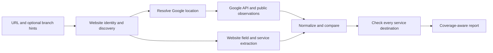

**Restaurant website ↔ Google Business Profile audit: technical specification and implementation plan**

Status: proposed, not implemented. Prepared 9 September 2026 against the current repository and current Google documentation.

Build a new `checkProfile` audit stage in the existing restaurant auditor. It should establish the correct restaurant branch, collect independent observations, compare every required field, validate customer-facing service destinations, and produce an evidence-backed report. Agreement establishes consistency; it does not establish real-world correctness. A phone-number comparison cannot prove a number is answered, and matching hours cannot prove the restaurant actually opens then.

The supplied screenshot is reference evidence. It shows a name, phone, menu, reservation and ordering labels, multiple providers, and a partial opening-hours summary. It does not reveal full destination URLs, all seven days, capture time, or current link health. No live GBP audit of Rimjhim was performed for this specification.

**1. Product contract**

Required input: restaurant website URL. Optional inputs: restaurant name, full street address/postcode, Google Place ID or Maps URL, managed GBP location resource, locale, IANA timezone, expected service URLs, and owner-approved facts. Inputs may arrive from the dashboard, CLI, or existing bulk imports. Keep separate records for multiple branches sharing one domain.

Default scope includes exact name, primary telephone, official website URL, regular weekly hours, date-specific exceptions where observable, and Menu, Reservations, and Online Ordering presence, destination correctness, and link health. All three service categories are required by default. Only an explicit operator policy may mark a service not applicable; the crawler must not infer an exemption from missing evidence.

Output is one location report per run, containing all successful comparisons, differences, missing fields, internal source conflicts, and unresolved checks. Include actionable recommendations without automatically changing the website or GBP. Optional approved facts enable a separate accuracy comparison; neither Google nor website content automatically overrides the other.

**2. Acquisition modes and coverage**

| Mode | Purpose | Coverage and limitations |
| --- | --- | --- |
| Public API | Audit an arbitrary restaurant using Places API (New) | Name, address, website, phone and hours when returned. Does not provide a complete inventory of menu/reservation/ordering destination URLs. |
| Owner connected | Audit locations the OAuth user manages using GBP APIs | Business information, supported menu URL attributes, and accessible place-action links. Requires project access approval and authorized location access. |
| Public observation supplement | Verify what a customer can actually see | Optional provider with documented coverage and suitable access/retention terms, or assisted browser observation. Locale, capture time, public visibility and completeness are recorded. |
| Imported observation | Accept an owner export, copied URLs or screenshot | Explicitly marked imported, timestamped if known, and limited to what the evidence actually reveals. Screenshots cannot establish hidden hrefs. |

The managed profile, Google-updated profile values, Places data, and rendered Search/Maps panel are different observations. Store them separately and report divergence. A configured action does not establish that its button is displayed to customers. Full public-display verification requires a public observation in addition to the management API.

Google requires GBP project approval and access to the managed business; creating an API key alone is insufficient. Use OAuth `business.manage`, but expose only retrieval methods in this feature. Keep its connection separate from the existing Search Console authorization, which does not grant GBP access. [GBP prerequisites](https://developers.google.com/my-business/content/prereqs), [Place Actions authorization](https://developers.google.com/my-business/reference/placeactions/rest/v1/locations.placeActionLinks/list).

For public data, use Text Search to discover candidates and Place Details for the selected Place ID. Request explicit field masks, not `*`: `id`, `displayName`, `formattedAddress`, `websiteUri`, `nationalPhoneNumber`, `internationalPhoneNumber`, `regularOpeningHours`, `currentOpeningHours`, `businessStatus`, `googleMapsUri`, `timeZone`, and attribution fields where needed. Secondary hours are opt-in. Requested fields determine billing tiers. `reservable`, `delivery`, and `takeout` are service indicators, not destination URLs. [Place Details](https://developers.google.com/maps/documentation/places/web-service/place-details), [Place resource](https://developers.google.com/maps/documentation/places/web-service/reference/rest/v1/places).

For owner-connected data, retrieve `locations/{id}` with a read mask for `title`, `phoneNumbers`, `websiteUri`, `storefrontAddress`, `regularHours`, `specialHours`, `moreHours`, `openInfo` and relevant metadata. Google-updated location values are a separate observation from `locations.getGoogleUpdated`. [Location resource](https://developers.google.com/my-business/reference/businessinformation/rest/v1/accounts.locations), [Google-updated values](https://developers.google.com/my-business/reference/businessinformation/rest/v1/locations/getGoogleUpdated).

For menu URLs, discover supported attributes for the category and country, then retrieve location attributes and inspect `attributes/url_menu` when supported. Record Google-updated attributes separately where available. Do not confuse structured food-menu items with the public menu hyperlink. [Manage Attributes](https://developers.google.com/my-business/content/attributes).

For reservations and ordering, paginate `locations/{id}/placeActionLinks` to exhaustion. Map `DINING_RESERVATION` to reservations and `FOOD_ORDERING`, `FOOD_DELIVERY`, and `FOOD_TAKEOUT` to ordering while preserving subtype. Retain `uri`, `providerType`, `isPreferred`, and `isEditable`. Audit merchant and aggregator links individually; an additional provider is not automatically a mismatch. Menu is not one of these action types. [Place Actions resource](https://developers.google.com/my-business/reference/placeactions/rest/v1/locations.placeActionLinks).

Do not make brittle, unattended Google DOM scraping the sole dependency. An optional browser adapter must stop at consent/CAPTCHA/access barriers and record incomplete coverage. Do not infer empty profiles from failed requests or promise a provider returns every public action.

**3. Recommended stack and repository integration**

| Layer | Recommendation |
| --- | --- |
| Runtime | Existing Node.js 24+ and TypeScript application |
| Website acquisition | Existing Playwright Chromium crawler plus HTTP fetch for static pages and documents |
| Extraction | Existing JSON-LD, microdata and visible-text parsers; deterministic service classification |
| Google integration | Separate typed adapters for Places, GBP information, attributes, place actions and optional public observations |
| Normalization | Existing URL utilities and interval code; add a maintained E.164 phone parser such as libphonenumber-js |
| Persistence | Existing SQLite jobs locally; separate expiring provider evidence from persistent operational records |
| User interface | Existing dashboard and CLI; side-by-side field comparison and coverage filters |
| Exports | Existing ExcelJS, CSV and JSON infrastructure, with source-aware export restrictions |
| Verification | Existing Node test runner and browser fixtures; authorized live acceptance checks |
| Hosted expansion | Durable jobs, external database/object storage and bounded browser workers; review the current hosted adapter separately |

Reuse `src/hours/*`, `src/scanner.ts`, `src/classifier.ts`, `src/urls.ts`, `src/robots.ts`, `src/database.ts`, `src/service.ts` and `src/reports.ts`. Add `src/profile/{model,audit,resolve,extract,normalize,compare,links,coverage}.ts` and adapters under `src/profile/providers/`. Shared extraction should avoid recrawling pages for the hours and profile stages.

The existing hours matcher verifies listings primarily by website host and accepts supplied Place IDs outright. The new resolver must validate branch identity independently. The existing hours stage defaults to a 15-minute tolerance and chooses one extraction layer; this feature defaults to zero and retains conflicting observations. Preserve old CLI behavior until a documented migration or explicitly selected profile mode changes it.

**4. Processing flow**



1. Validate URL and network scope. Record original URL, redirects and resolved official landing page. Load robots directives, sitemap and rendered homepage; prioritize contact, hours, menu, booking and ordering pages.
2. Extract name/address/phone candidates and resolve the restaurant branch. Start with a supplied Place ID or connected location, but still check identity. Otherwise search by name plus street/postcode. Use address, location coordinates when available, phone and domain as supporting signals. Shared brand/domain alone is insufficient. A domain mismatch must remain detectable rather than disqualifying the correct restaurant. Unresolved or close candidates require selection; continue website-only checks meanwhile.
3. Fetch Google observations and capability metadata. Exhaust list pagination, record requested/returned fields, and distinguish unsupported, unauthorized, omitted, rate-limited and failed reads.
4. Crawl and extract website claims. Read Restaurant/LocalBusiness JSON-LD, microdata, visible branding, contact text, `tel:` anchors, footer, navigation, buttons, PDFs and relevant frames. Capture source URL, JSON path or DOM locator, short excerpt and extraction confidence. Retain alternatives: conflicting footer/contact/schema hours generate `source_conflict` rather than an invented merged schedule.
5. Normalize into typed facts while retaining originals under the applicable retention rules. Run deterministic comparisons and generate one check per requirement and per schedule day/service link.
6. Visit all observed service URLs from both sources. Compare destination identity, service purpose and availability, then emit health results separately from equality results.
7. Generate a report even on partial failure or cancellation. Resume from durable checkpoints; refresh expired provider observations before comparing again.

Proposed initial crawl defaults: 20 discovered pages per branch, depth 2, two concurrent navigations per host, 500 ms host delay, 30-second navigation timeout, ten redirect hops and two bounded retries with jitter for transient errors. Honor Retry-After. Discovered caps are configurable; explicitly supplied URLs remain queued individually. Hitting a cap lowers coverage and prevents an unqualified absence claim. Log page/API counts and provider budgets per run.

**5. Comparison rules**

| Requirement | Strict result | Additional interpretation |
| --- | --- | --- |
| Restaurant name | Same extracted displayed name, preserving case and punctuation | Keep a separate normalized similarity result for formatting or likely branding differences. Similarity never passes the exact-name requirement. Compare trading name, not SEO title or legal-company suffix by default. |
| Telephone | Same published string | Parse both using the restaurant country, compare E.164 plus extension. A formatting difference may be semantically equivalent. Distinguish primary, additional and tracking numbers. |
| Official website | Same declared URL | Compare resolved destinations separately. Normalize host case/default ports; preserve meaningful paths, query parameters and fragments. Verify redirects before treating HTTP/HTTPS or www variants as equivalent. |
| Weekly hours | Same explicit open/closed state and complete interval set for each of seven days | Unknown is not closed. Support split shifts, 24-hour days, overnight intervals and Sunday-to-Monday rollover. Zero-minute tolerance by default; optional tolerance changes severity only, not exact equality. |
| Special hours | Same date-specific schedule for the same date and timezone | Compare overlapping observable dates; do not compare holiday overrides to a regular-week template. Keep delivery/takeaway hours separate from dining hours. |
| Services | Presence on each source plus correct matching destination for the required service | Report literal URL equality, verified destination equivalence and health separately. Record extra valid providers informationally. A generic homepage may be reachable but fail the service-destination check. |

Name extraction may decode HTML entities and remove surrounding layout whitespace; store the pre-cleaned evidence. Do not case-fold or drop punctuation for the exact comparison. Phone formatting and URL differences remain visible even when operational equivalence is established.

For hours, use an IANA timezone, e.g. Europe/London for a verified Southampton location, rather than the auditor computer's timezone. Represent local intervals explicitly with a closing-day offset. Preserve original intervals, then compare equivalent covered time ranges so differing overnight representations do not create false differences. Compare date overrides using DST-aware calendar dates. Missing timezone limits date-specific checks. Places current hours cover the next seven days including applicable exceptions; future exceptions beyond the returned window remain unobserved. [Opening hours fields](https://developers.google.com/maps/documentation/places/web-service/reference/rest/v1/places).

**6. Functional link audit**

Discover services through navigation labels and synonyms, structured-data links/actions, embedded providers, accessible buttons, page content and menu downloads. An anchor section or modal can satisfy website presence without a separate path. A GBP URL must still lead customers to an accessible version of that service.

For each link retain origin, label, actual href, redirects, final URL, final HTTP status, content type, latency, branch identity evidence and rendered service evidence. A displayed domain is insufficient to establish href equality.

Use GET/navigation rather than trusting HEAD. Check status codes explicitly: a page load can succeed while returning a 404. Assess successful HTTP responses for suspected soft 404s, empty applications, expired domains, unrelated locations and absent service UI. Validate PDF menus as documents and inspect embedded booking/ordering interfaces where accessible. [Playwright navigation](https://playwright.dev/docs/api/class-page#page-goto).

Health values: `functional`, `hard_404`, `gone_410`, `soft_404_suspected`, `wrong_destination`, `wrong_location`, `server_error`, `blocked`, `timeout`, `network_error`, `temporarily_unavailable`, `unverified`. Redirecting successfully is recorded, not automatically treated as broken. A restaurant being closed now or having no reservation slots does not by itself mean its link is broken.

Functional means the correct service interface loads sufficiently to start the customer journey. Stop before submitting reservations, orders, payments or personal information. Distinguish menu visibility, booking-widget readiness, ordering-interface readiness and untested transaction completion. Never report a successfully completed transaction from these checks.

**7. Report model**

Use a versioned, runtime-validated schema. The following is the logical model, not a blanket permission to persist provider values. Sensitive/restricted fields may exist only in memory and be redacted from stored/exported representations.

```ts
type ObservationState =
  | 'present' | 'not_found' | 'unsupported' | 'unauthorized'
  | 'blocked' | 'error' | 'ambiguous' | 'not_checked';

type Verdict =
  | 'match' | 'equivalent' | 'mismatch'
  | 'missing_website' | 'missing_google' | 'missing_both'
  | 'source_conflict' | 'unverifiable' | 'not_applicable';

interface Observation<T> {
  id: string;
  field: string;
  source: 'website' | 'places' | 'gbp_managed' | 'gbp_google_updated'
    | 'google_public' | 'imported' | 'owner_approved';
  state: ObservationState;
  raw: unknown;
  normalized: T | null;
  observedAt: string | null;
  retrievedAt: string;
  confidence: 'high' | 'medium' | 'low';
  evidence: {
    url?: string;
    resourceName?: string;
    locator?: string;
    excerpt?: string;
    artifactId?: string;
  };
  retention: {
    policyId: string;
    persistAllowed: boolean;
    exportAllowed: boolean;
    expiresAt: string | null;
  };
}

interface ScheduleDay {
  day: 'MON' | 'TUE' | 'WED' | 'THU' | 'FRI' | 'SAT' | 'SUN';
  state: 'open' | 'closed' | 'unknown';
  intervals: Array<{
    open: string;       // local HH:mm
    close: string;      // local HH:mm
    closeDayOffset: number;
  }>;
}

interface Schedule {
  timezone: string | null;
  service: 'general' | 'dining' | 'delivery' | 'takeaway';
  weekly: ScheduleDay[];
  exceptions: Array<{
    date: string;       // local YYYY-MM-DD
    state: 'open' | 'closed' | 'unknown';
    intervals: ScheduleDay['intervals'];
  }>;
}

interface LinkAudit {
  id: string;
  service: 'menu' | 'reservations' | 'ordering';
  sourceObservationId: string;
  url: string;
  provider: string | null;
  preferred: boolean | null;
  redirectChain: Array<{url: string; status: number | null}>;
  finalUrl: string | null;
  httpStatus: number | null;
  health: string;       // constrained to the health enum above
  correctBranch: boolean | null;
  serviceReady: boolean | null;
  transactionTested: false;
  checkedAt: string;
  reasonCodes: string[];
}

interface Check {
  id: string;
  field: string;        // name, hours.regular.MON, services.menu.url, etc.
  verdict: Verdict;
  exactMatch: boolean | null;
  semanticMatch: boolean | null;
  severity: 'info' | 'warning' | 'error';
  websiteObservationIds: string[];
  googleObservationIds: string[];
  linkAuditIds: string[];
  reasonCodes: string[];
  recommendation: string;
  accuracyAgainstApprovedFact: 'pass' | 'fail' | 'not_checked';
}

interface ProfileAuditReport {
  schemaVersion: '1.0';
  auditId: string;
  startedAt: string;
  completedAt: string | null;
  input: {websiteUrl: string; placeId?: string; gbpLocation?: string};
  identity: {
    status: 'verified' | 'ambiguous' | 'unmatched' | 'unverified';
    placeId: string | null;
    evidenceObservationIds: string[];
    rationale: string[];
  };
  rules: {version: string; hoursToleranceMinutes: number; requiredServices: string[]};
  status: 'completed' | 'completed_partial' | 'cancelled' | 'failed';
  coverage: Array<{
    source: string; field: string;
    state: 'complete' | 'partial' | 'unavailable' | 'not_checked';
    scope: string; reason: string | null;
  }>;
  observations: Observation<unknown>[];
  checks: Check[];
  links: LinkAudit[];
  summary: {
    requiredChecks: number;
    conclusiveChecks: number;
    exactMatches: number;
    equivalentOnly: number;
    mismatches: number;
    missing: number;
    unverifiable: number;
    brokenLinks: number;
  };
  warnings: string[];
}
```

Keep run completion separate from audit outcome: a completed audit can have failures. A complete report includes a row for every required check even when unavailable. Unobserved API fields use `unverifiable`, not `missing_google`. A website `not_found` observation supports a scoped missing finding only when discovery coverage is sufficient; otherwise mark unverifiable and describe the pages inspected. An absent managed attribute establishes only its absence in that managed source, not universal absence from the public panel.

Report coverage as conclusive required checks / applicable required checks. Show exact agreement, semantic equivalence, missing fields and unknowns separately; avoid a single percentage that can conceal unknowns. Overall pass requires verified branch identity, all mandatory checks conclusive, all strict requirements satisfied, and required destinations functional. Equivalence alone does not pass a strict identity requirement.

Dashboard columns: Requirement, Website value, Google value/source, Exact match, Operational equivalence, Link health, Severity, Evidence, Recommended action. Show separate views for weekly hours, date exceptions, provider links and source coverage. Sort actionable failures first while keeping successful rows available.

Export a human-readable HTML report, `profile-audit.json`, flattened field/day/link CSV files, and workbook sheets `Profile Summary`, `Field Comparisons`, `Weekly Hours`, `Special Hours`, `Service Links`, `Coverage & Evidence`. Escape untrusted HTML and spreadsheet formula prefixes. Apply retention/export policy to all artifacts and evidence references, not just database tables.

**8. Persistence, access and operational safeguards**

Proposed tables: `profile_audits`, `profile_locations`, `profile_observations`, `profile_checks`, `profile_link_checks`, and `profile_checkpoints`. Index audit/location/field and expiration times. Use immutable run IDs, stage checkpoints and a work-item key containing branch, source, field and URL; retain distinct observations even when URL checks can be reused within a fresh run.

Implement source-specific retention before enabling Google-derived report archives. Places restricts caching/storage except permitted cases such as Place IDs and requires attribution. GBP permits limited temporary storage under specific conditions, including a maximum of 30 calendar days; this is not unrestricted permission to archive or aggregate normalized data. [Places policies](https://developers.google.com/maps/documentation/places/web-service/policies), [GBP policies](https://developers.google.com/my-business/content/policies).

Default Google content persistence/export to disabled until the applicable use is established. Perform comparisons in memory and enable retained values, derived findings, screenshots and downloadable artifacts only where the source terms permit them. Do not assume derived values or third-party providers bypass restrictions. Release planning must resolve the desired persistent comprehensive report against those terms; a restricted deployment can show fresh comparisons with permitted operational metadata and owner-provided evidence instead. Expiry jobs must remove related artifacts as well as rows, and resumptions must refetch expired content.

Keep OAuth refresh tokens in the existing secure credential mechanism, not report data. Validate redirect state, restrict API keys, redact credentials and separate tenant/location access for hosted deployments. Enforce SSRF controls for initial URLs, redirects, frames and browser subrequests: reject private, loopback, link-local and metadata destinations, including DNS rebinding paths. Keep fixtures behind a test-only exception. Use browser isolation, bounded downloads and robots-aware crawling. Treat website text, screenshots and provider content as data, never as executable instructions.

**9. Delivery plan and acceptance gates**

| Phase | Deliverables | Acceptance gate | Planning estimate |
| --- | --- | --- | --- |
| 1. Access and contracts | Source capability matrix, connected test location, approved data-retention/export design, runtime schema and fixture inventory | Demonstrate actual information, menu attributes and paginated action-link reads; public-only gaps explicit | 2–3 days, plus external approval wait |
| 2. Identity and extraction | Branch resolver, names/phone/website extraction, retained source conflicts, service discovery | Shared-domain branches, wrong supplied IDs and incorrect GBP website URLs handled without wrong-branch comparisons | 3–4 days |
| 3. Comparison engine | Exact and equivalent results, seven-day intervals, special/service hours, completeness rules | Deterministic fixtures cover every rule and unknown never becomes closed/missing/pass | 3–4 days |
| 4. Service destinations | Merchant/aggregator URL checks, PDFs/widgets, wrong-location and soft-404 detection | Correct service readiness established without bookings/orders; blockers remain unknown | 3–4 days |
| 5. Integration and reports | Dashboard, CLI/API options, database migration, progress/resume/cancel, policy-aware exports | Existing hours/404 behavior preserved; partial runs and expiry/resume produce consistent reports | 3–4 days |
| 6. Live acceptance | Authorized restaurant samples, manually checked findings and documentation | Exact selected GBP, full website journey and all required report rows verified; limitations documented | 2–3 days |

Indicative effort is 16–22 engineering days for one engineer familiar with this repository, excluding Google approval and broad third-party widget support. The first release can ship core public comparisons earlier, explicitly labeled partial for unsupported Google service URLs. Full service-link verification requires the owner-connected and/or suitable public-observation paths.

Proposed integration: add `checkProfile`, provider mode, optional Place ID/GBP resource, required services and zero-default profile-hours tolerance to scan options. Add profile stages to the existing job state machine and progress events. Extend the current scan creation/detail/export APIs with versioned profile results rather than building a second job engine. Proposed CLI option: `--check-profile`, with explicit source selection and no silent fallback. These options do not exist yet.

Required fixtures include exact/near names; UK national/international phones and extensions; www and tracking redirects; significant query/fragment links; same-domain branches; mismatched website field; split/overnight/24-hour/DST schedules; unknown days and holiday overrides; conflicting structured/visible text; HTML/PDF menus; embedded widgets; multiple preferred/third-party actions; 404/410/soft-404/5xx; consent/403/429; partial pagination; cancellation/resume; expired evidence; SSRF redirects; and export escaping.

Run the repository's typecheck, focused new tests, affected integration suite and build. Complete a controlled end-to-end fixture that renders website data, serves recorded provider responses and verifies exported rows, then perform a read-only live check against an owner-authorized profile. For Rimjhim specifically, verify the branch, inspect actual menu/reservation/order hrefs, expand all weekly hours, and compare with the website; the supplied screenshot alone cannot satisfy that acceptance gate.
